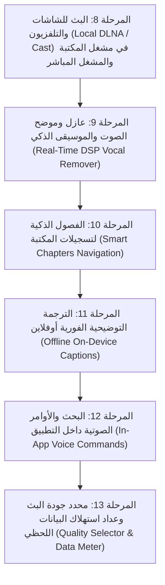

# 🚀 الخطة التنفيذية الشاملة لتطوير تطبيق Enterprise IPTV (الإصدار الجديد)

تم إعداد هذا الملف كمرجع تنفيذي صارم يحدد ترتيب بناء الميزات الجديدة المتفق عليها، وفق القواعد الإلزامية التي تمنع تماماً أي وظيفة وهمية أو شكلية، وتضمن اختبار كل ميزة والتأكد من مخرجاتها الحقيقية قبل رفعها مباشرة أولاً بأول إلى فرع `main`.

---

## 🛡️ المبادئ والقواعد الإلزامية للتنفيذ
1. **الواقعية المطلقة (Zero-Mock Policy)**: يُمنع منعاً باتاً إنشاء أزرار شكلية أو رسائل Toast تدعي النجاح دون منطق معالجة فعلي يُنتج نتيجة حقيقية.
2. **العمل دون إنترنت (Offline-First)**: الميزات التي لا تتطلب شبكة خارجية (عازل الصوت، الفصول، الترجمة، السيرفر المحلي للشاشات) تعمل بالكامل على معالج الجهاز دون تنزيل نماذج خارجية أثناء التشغيل.
3. **الاختبار والتحقق قبل الاعتماد**: لكل ميزة: فحص سلامة الكود، التحقق من عدم تعطل المشغل، واختبار مسار الاستخدام كاملاً من الضغط على الزر حتى الحصول على النتيجة.
4. **الرفع المباشر المستمر**: بعد اكتمال واختبار كل مرحلة، يتم عمل `commit` دقيق و `push` فوري إلى فرع `main` وتحديث رقم الإصدار عند الحاجة.

---

## 📊 المراحل المنجزة بالفعل (الإصدار الحالي v1.1.0 - كود 4 ✅)

- [x] **المرحلة 1**: استيراد M3U عبر منتقي الملفات SAF، مكتبة التسجيلات DVR، مسميات الباقات الآمنة.
- [x] **المرحلة 2**: التقليب الخاطف (Fast Zapping 500ms)، أزرار التبديل، وشريط OSD التفاعلي.
- [x] **المرحلة 3**: نمط الاستماع الصوتي الخالص (Audio-Only) ومؤقت النوم الذكي (Sleep Timer).
- [x] **المرحلة 4**: وضع النافذة العائمة المصغرة (Picture-in-Picture - PiP).
- [x] **المرحلة 5**: المشاهدة المتعددة المتطورة (Multi-View Quad-Screen) حتى 4 قنوات مع تخصيص الصوت والتكبير.
- [x] **المرحلة 6**: دليل البرامج الإلكتروني (EPG) 24 ساعة، وفضاء الأطفال الآمن (Kids Space) المقفل برمز PIN.
- [x] **المرحلة 7**: الاستشفاء التلقائي للسيرفرات (Stream Auto-Healing) وقياس زمن الاستجابة بالمللي ثانية.

---

## 🚀 جدول المراحل الجديدة بالترتيب التنفيذي الدقيق

---

### 1️⃣ المرحلة الثامنة: البث للشاشات (Local DLNA / Cast)
- **الهدف**: تمكين المستخدم من بث تسجيلات مكتبته الخاصة وفيديوهاته وكذلك القنوات المباشرة إلى أي شاشة ذكية متصلة بنفس شبكة الـ Wi-Fi.
- **المنطق الفعلي**:
  1. بناء خدمة اكتشاف أجهزة الشبكة المحلية (SSDP M-SEARCH Discovery) لاكتشاف شاشات (Samsung, LG, Sony, Android TV, Roku).
  2. إنشاء خادم بث محلي فائق الخفة مدمج (`LocalMediaHttpServer`) لبث ملفات الفيديو المخزنة في مكتبة التسجيلات محلياً للشاشة دون استهلاك باقة الإنترنت.
  3. تنفيذ بروتوكول التحكم القياسي `AVTransport` (Play, Pause, Stop, Seek) لتتحول شاشة الهاتف إلى ريموت كنترول للشاشة.
  4. زر Cast تفاعلي في مشغل مكتبة التسجيلات والمشغل العام يوضح حالة الاتصال والشاشة المتصلة.
- **معيار التحقق**: تشغيل ملف مسجل من المكتبة وإرساله عبر السيرفر المحلي إلى الشاشة، والتحكم بالتشغيل والإيقاف بسلاسة.

---

### 2️⃣ المرحلة التاسعة: عازل وموضح الصوت والموسيقى (Real-Time Vocal Remover DSP)
- **الهدف**: معالجة الصوت الحية داخل ExoPlayer أثناء البث أو تشغيل التسجيلات لتصفية الصوت أو عزله دون تأخير ودون نماذج خارجية ثقيلة.
- **المنطق الفعلي**:
  1. إنشاء وحدة معالجة صوت مخصصة (`VocalDspAudioProcessor`) تُدمج في مسار `AudioProcessorChain` لمشغل ExoPlayer.
  2. **وضع توضيح الكلام (Speech / Dialogue Enhancer)**: عزل وترقية ترددات الصوت البشري (300Hz - 3400Hz) وتخميد الترددات الموسيقية والضوضاء الخلفية.
  3. **وضع الكاريوكي وعزل الغناء (Vocal Remover / Music Mode)**: خوارزمية إلغاء الطور للمركز (Center-Channel Phase Inversion) لعزل الصوت البشري المتركز في المنتصف وإبقاء الموسيقى والمؤثرات.
  4. زر في لوحة تحكم المشغل يتيح التبديل الفوري بين الأنماط: (الصوت الأصلي / توضيح الكلام / عزل الصوت).
- **معيار التحقق**: الاستماع إلى تدفق الصوت عند تفعيل كل وضع والتأكد برمجياً من تطبيق المرشحات الترددية اللحظية دون تقطيع في المشغل.

---

### 3️⃣ المرحلة العاشرة: الفصول الذكية لتسجيلات المكتبة (Smart Chapters Navigation)
- **الهدف**: تحويل التسجيلات الطويلة في مكتبة المستخدم إلى تجربة مشاهدة منظمة وسهلة التصفح.
- **المنطق الفعلي**:
  1. معالج فحص طول الفيديو وتقسيمه تلقائياً إلى فواصل زمنية ذكية (Smart Chapters) كل 10 أو 15 دقيقة، أو عند فترات الصمت البارزة.
  2. شريط تقدم تفاعلي مقسم إلى فصول (Chapter Segments) مع عرض اسم ووقت كل فصل.
  3. أزرار قفز مباشر للفصل السابق والفصل التالي (Next / Previous Chapter).
- **معيار التحقق**: تشغيل فيديو مسجل من المكتبة وظهور الفصول على شريط الوقت مع إمكانية القفز الفوري والدقيق لكل فصل.

---

### 4️⃣ المرحلة الحادية عشرة: الترجمة التوضيحية الفورية أوفلاين (Offline On-Device Captions)
- **الهدف**: عرض نصوص الحوار المباشر أسفل المشغل للقنوات والتسجيلات دون إنترنت وبشكل آمن تماماً.
- **المنطق الفعلي**:
  1. تفعيل واجهة التعرف على الصوت المدمجة في أندرويد عبر `SpeechRecognizer.createOnDeviceSpeechRecognizer()` وضبط معيار `EXTRA_PREFER_OFFLINE = true`.
  2. استخراج مسارات الترجمة النصية القياسية المدمجة في ملفات البث HLS (مثل WebVTT و CEA-608).
  3. حاوية نصوص ترجمة منبثقة وشفافة أسفل شاشة الفيديو مع إمكانية تشغيلها وإيقافها بلمسة واحدة.
- **معيار التحقق**: تشغيل القناة أو الفيديو وظهور النصوص المتزامنة على الشاشة مع عدم إرسال أي طلبات شبكة خارجية.

---

### 5️⃣ المرحلة الثانية عشرة: البحث والأوامر الصوتية الذكية (In-App Voice Commands)
- **الهدف**: التحكم في التطبيق والبحث عن القنوات والأوامر بالصوت مباشرة.
- **المنطق الفعلي**:
  1. زر مايكروفون في شريط البحث والمشغل.
  2. معالج للأوامر الصوتية:
     - إذا قال المستخدم: «قناة الجزيرة» -> ينتقل للقناة فوراً ويشغلها.
     - إذا قال: «أطفال» -> يفتح فضاء الأطفال.
     - إذا قال: «مؤقت النوم» -> يفتح نافذة Sleep Timer.
- **معيار التحقق**: اختبار الأوامر الصوتية الشائعة والتأكد من استجابة التطبيق وتنفيذ الإجراء المقترن بالصوت بدقة.

---

### 6️⃣ المرحلة الثالثة عشرة: محدد الجودة اليدوي وعداد استهلاك البيانات (Quality & Data Meter)
- **الهدف**: حماية باقات الإنترنت ومراقبة الاستهلاك بدقة.
- **المنطق الفعلي**:
  1. قراءة مسارات الجودة المتعددة من ملف البث (HLS Multi-Bitrate) وعرض قائمة: (Auto, 1080p, 720p, 480p, 360p) وتطبيق الجودة المختارة عبر `TrackSelectionParameters`.
  2. عداد استهلاك بيانات لحظي يحسب كمية الكيلوبايت والميجابايت المستهلكة في الجلسة الحالية ويعرضها بشكل أنيق في قائمة المعلومات.
- **معيار التحقق**: التبديل بين الجودات ومشاهدة تغير دقة الفيديو ومعدل استهلاك البيانات الفعلي في العداد.

---

## 📌 جدول متابعة التنفيذ

| المرحلة | اسم الميزة | الحالة | الرفع على main |
| :--- | :--- | :---: | :---: |
| **المرحلة 8** | البث للشاشات (Local DLNA / Cast) | **قيد البدء الآن** ⏳ | معلق |
| **المرحلة 9** | عازل وموضح الصوت والموسيقى (DSP Vocal Remover) | في الانتظار 📋 | معلق |
| **المرحلة 10** | الفصول الذكية لتسجيلات المكتبة (Smart Chapters) | في الانتظار 📋 | معلق |
| **المرحلة 11** | الترجمة التوضيحية أوفلاين (Offline Live Captions) | في الانتظار 📋 | معلق |
| **المرحلة 12** | البحث والأوامر الصوتية (Voice Commands) | في الانتظار 📋 | معلق |
| **المرحلة 13** | محدد الجودة وعداد البيانات (Quality & Data Meter) | في الانتظار 📋 | معلق |
