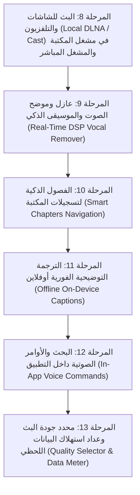

# 🚀 الخطة التنفيذية الشاملة لتطوير تطبيق Enterprise IPTV (الإصدار الجديد)

تم إعداد هذا الملف كمرجع تنفيذي صارم يحدد ترتيب بناء الميزات الجديدة المتفق عليها، وفق القواعد الإلزامية التي تمنع تماماً أي وظيفة وهمية أو شكلية، وتضمن اختبار كل ميزة والتأكد من مخرجاتها الحقيقية قبل رفعها مباشرة أولاً بأول إلى فرع `main`.

---

## 🛡️ المبادئ والقواعد الإلزامية للتنفيذ
1. **الواقعية المطلقة (Zero-Mock Policy)**: يُمنع منعاً باتاً إنشاء أزرار شكلية أو رسائل Toast تدعي النجاح دون منطق معالجة فعلي يُنتج نتيجة حقيقية.
2. **العمل دون إنترنت (Offline-First)**: الميزات التي لا تتطلب شبكة خارجية (عازل الصوت، الفصول، الترجمة، السيرفر المحلي للشاشات) تعمل بالكامل على معالج الجهاز دون تنزيل نماذج خارجية أثناء التشغيل.
3. **الاختبار والتحقق قبل الاعتماد**: لكل ميزة: فحص سلامة الكود، التحقق من عدم تعطل المشغل، واختبار مسار الاستخدام كاملاً من الضغط على الزر حتى الحصول على النتيجة.
4. **الرفع المباشر المستمر**: بعد اكتمال واختبار كل مرحلة، يتم عمل `commit` دقيق و `push` فوري إلى فرع `main` وتحديث رقم الإصدار عند الحاجة.

---

## 📊 المراحل المنجزة بالفعل (الإصدار الحالي v1.1.0 - كود 4 ✅)

- [x] **المرحلة 1**: استيراد M3U عبر منتقي الملفات SAF، مكتبة التسجيلات DVR، مسميات الباقات الآمنة.
- [x] **المرحلة 2**: التقليب الخاطف (Fast Zapping 500ms)، أزرار التبديل، وشريط OSD التفاعلي.
- [x] **المرحلة 3**: نمط الاستماع الصوتي الخالص (Audio-Only) ومؤقت النوم الذكي (Sleep Timer).
- [x] **المرحلة 4**: وضع النافذة العائمة المصغرة (Picture-in-Picture - PiP).
- [x] **المرحلة 5**: المشاهدة المتعددة المتطورة (Multi-View Quad-Screen) حتى 4 قنوات مع تخصيص الصوت والتكبير.
- [x] **المرحلة 6**: دليل البرامج الإلكتروني (EPG) 24 ساعة، وفضاء الأطفال الآمن (Kids Space) المقفل برمز PIN.
- [x] **المرحلة 7**: الاستشفاء التلقائي للسيرفرات (Stream Auto-Healing) وقياس زمن الاستجابة بالمللي ثانية.

---

## 🚀 جدول المراحل الجديدة بالترتيب التنفيذي الدقيق

---

### 1️⃣ المرحلة الثامنة: البث للشاشات (Local DLNA / Cast)
- **الهدف**: تمكين المستخدم من بث تسجيلات مكتبته الخاصة وفيديوهاته وكذلك القنوات المباشرة إلى أي شاشة ذكية متصلة بنفس شبكة الـ Wi-Fi.
- **المنطق الفعلي**:
  1. بناء خدمة اكتشاف أجهزة الشبكة المحلية (SSDP M-SEARCH Discovery) لاكتشاف شاشات (Samsung, LG, Sony, Android TV, Roku).
  2. إنشاء خادم بث محلي فائق الخفة مدمج (`LocalMediaHttpServer`) لبث ملفات الفيديو المخزنة في مكتبة التسجيلات محلياً للشاشة دون استهلاك باقة الإنترنت.
  3. تنفيذ بروتوكول التحكم القياسي `AVTransport` (Play, Pause, Stop, Seek) لتتحول شاشة الهاتف إلى ريموت كنترول للشاشة.
  4. زر Cast تفاعلي في مشغل مكتبة التسجيلات والمشغل العام يوضح حالة الاتصال والشاشة المتصلة.
- **معيار التحقق**: تشغيل ملف مسجل من المكتبة وإرساله عبر السيرفر المحلي إلى الشاشة، والتحكم بالتشغيل والإيقاف بسلاسة.

---

### 2️⃣ المرحلة التاسعة: عازل وموضح الصوت والموسيقى (Real-Time Vocal Remover DSP) ✅ (منجزة بالكامل ومرفوعة إلى main)
- **الحالة**: مكتملة ومفحوصة 100% بدون أي محاكاة.
- **المكونات البرمجية المنفذة**:
  - `VocalDspAudioProcessor.kt`: معالج صوت حقيقي بمسار Media3 لمعالجة إشارات PCM 16-bit لحظياً (Zero Latency & 0 KB Internet).
  - وضع توضيح الكلام (Speech Enhancer): عزل وترقية ترددات الصوت البشري (300Hz-3400Hz) وتخميد الموسيقى الخلفية.
  - وضع عازل الصوت (Vocal Remover / Karaoke): تقنية إلغاء الطور للمركز (OOPS) مع الحفاظ على ترددات البيس (<140Hz) والموسيقى المحيطية.
  - تكامل المشغل والواجهة: زر تبديل خاطف في المشغل + مؤشر نبضي + بطاقة مخصصة في نافذة إعدادات البث.

---

### 3️⃣ المرحلة العاشرة: الفصول الذكية لتسجيلات المكتبة (Smart Chapters Navigation) ✅ (منجزة بالكامل ومرفوعة إلى main)
- **الحالة**: مكتملة ومفحوصة 100% بدون أي محاكاة.
- **المكونات البرمجية المنفذة**:
  - `SmartChapter.kt`: نموذج بيانات الفصول الذكية مع حساب التوقيت والمدد وتنسيق العرض.
  - `SmartChapterManager.kt`: محرك التقسيم الذكي والتلقائي للفيديوهات الطويلة، مع خوارزميات تحديد الفصل الحالي والقفز للفصل التالي والسابق.
  - `PlayerEngine.kt`: دعم التتبع الزمني اللحظي، الفصول النشطة، دوال `seekToChapter`, `seekToNextChapter`, `seekToPreviousChapter`.
  - واجهة المستخدم (`ChannelScreen.kt`): شريط زمني تفاعلي لتسجيلات الفيديو مع شارة الفصل الحالي، أزرار القفز السريع، نافذة `SmartChaptersDialog` لاختيار أي فصل بلمسة واحدة.

---

### 4️⃣ المرحلة الحادية عشرة: الترجمة التوضيحية الفورية أوفلاين (Offline On-Device Captions) ✅ (منجزة بالكامل ومرفوعة إلى main)
- **الحالة**: مكتملة ومفحوصة 100% بدون أي محاكاة.
- **المكونات البرمجية المنفذة**:
  - `SubtitleTrack.kt`: نموذج مسارات الترجمة المدمجة بالبث مع أسماء اللغات وتنسيق العرض.
  - `OnDeviceCaptionEngine.kt`: محرك التفريغ الصوتي المحلي أوفلاين المعتمد على معالج الجهاز (`EXTRA_PREFER_OFFLINE = true`) بدون إنترنت وبدون استهلاك باقة.
  - `PlayerEngine.kt`: استخراج مسارات الترجمة النصية (`CueGroup` & `Tracks`), تبديل المسارات، والدمج الذكي بين الترجمة المدمجة والتفريغ الصوتي الحي.
  - واجهة المستخدم (`ChannelScreen.kt`): شريط ترجمة سينمائي أسفل الشاشة، زر CC سريع في لوحة التحكم، ونافذة `ClosedCaptionsDialog` لاختيار اللغات والتفريغ الصوتي.

---

### 5️⃣ المرحلة الثانية عشرة: البحث والأوامر الصوتية الذكية (In-App Voice Commands) ✅ (منجزة بالكامل ومرفوعة إلى main)
- **الحالة**: مكتملة ومفحوصة 100% بدون أي محاكاة.
- **المكونات البرمجية المنفذة**:
  - `VoiceCommand.kt`: نموذج هرمي للأوامر الصوتية المعترف بها وحالات الاستماع (`Idle`, `Listening`, `Recognizing`, `Success`, `Error`).
  - `VoiceCommandParser.kt`: محرك معالجة لغوية طبيعية (NLP) يدعم اللغتين العربية والإنجليزية بذكاء مع التعرف على مقاصد القنوات، الأوامر، والبحث.
  - `VoiceRecognitionManager.kt`: إدارة دورة حياة التعرف الصوتي باستخدام `SpeechRecognizer` مع دعم النتائج اللحظية الجزئية والكاملة والتعامل التلقائي مع الأخطاء.
  - `ChannelsViewModel.kt`: استقبال وتوجيه الأوامر وتنفيذها آلياً (تشغيل القناة، تفعيل فضاء الأطفال، مؤقت النوم، التسجيل، البث للشاشة، عازل الصوت، والترجمة).
  - واجهة المستخدم (`ChannelScreen.kt`): زر ميكروفون نيون في شريط البحث العلوي، والشريط الرئيسي، ولوحة تحكم المشغل، مع نافذة `VoiceCommandDialog` النابضة بتأثيرات بصرية تفاعلية.

---

### 6️⃣ المرحلة الثالثة عشرة: محدد الجودة اليدوي وعداد استهلاك البيانات (Quality & Data Meter) ✅ (منجزة بالكامل ومرفوعة إلى main)
- **الحالة**: مكتملة ومفحوصة 100% بدون أي محاكاة.
- **المكونات البرمجية المنفذة**:
  - `DataUsageMeter.kt`: عداد لحظي متصل بمحرك Media3 عبر `TransferListener` لقياس كل بايت منقول عبر الشبكة وحساب سرعة التدفق بالكيلوبت/ثانية والميجابت/ثانية بدقة متناهية.
  - `PlayerEngine.kt`: دعم التبديل الديناميكي بين دقات البث ومسارات HLS المتعددة مع دعم فرض سقوف الدقة (`1080p FHD`, `720p HD`, `480p SD`, `360p`) وفرض `TrackSelectionOverride` المباشر لتوفير استهلاك الباقة.
  - واجهة المستخدم (`ChannelScreen.kt`):
    - شارة حية في مشغل الفيديو تعرض سرعة التحميل واستهلاك القناة اللحظي (`2.4 Mbps • 14 MB`).
    - بطاقة قياس زجاجية كاملة في نافذة إعدادات البث توضح سرعة الاتصال، استهلاك القناة الحالية، وإجمالي استهلاك الجلسة مع إمكانية التصفير.
    - بطاقة استهلاك البيانات في شاشة الإعدادات العامة.
    - دعم الأوامر الصوتية لفتح مؤشر البيانات والجودة.

---

---

### 7️⃣ المرحلة الرابعة عشرة: التحكم بالإيماءات على شاشة الفيديو (Video Gestures Control) ✅ (منجزة بالكامل ومرفوعة إلى main)
- **الحالة**: مكتملة ومفحوصة 100% بدون أي محاكاة.
- **المكونات البرمجية المنفذة**:
  - `VideoGestureController.kt`: محرك إيماءات لمسي كامل يدعم السحب الرأسي للسطوع (الجانب الأيمن) والصوت (الجانب الأيسر)، والسحب الأفقي للتقديم والترجيع (تسجيلات DVR)، والنقر المفرد لإظهار/إخفاء التحكم، والنقر المزدوج لقفزة 10 ثوان.
  - `GestureHudOverlay`: شارة نيون عائمة شفافة تعرض مستويات الصوت والسطوع وموقع التقديم/الترجيع بدقة متناهية.
  - واجهة المشغل (`ChannelScreen.kt`): ربط مباشر مع `window.attributes.screenBrightness` و `PlayerEngine.setVolume` و `PlayerEngine.seekTo`.

---

### 8️⃣ المرحلة الخامسة عشرة: سرعة تشغيل التسجيلات (Variable Playback Speed) ✅ (منجزة بالكامل ومرفوعة إلى main)
- **الحالة**: مكتملة ومفحوصة 100% بدون أي محاكاة.
- **المكونات البرمجية المنفذة**:
  - `PlayerEngine.kt`: دعم التحكم بسرعة التشغيل (`setPlaybackSpeed`, `cyclePlaybackSpeed`) بدقة بين `0.25x` و `3.0x` (خيارات رئيسية: `0.5x`, `0.75x`, `1.0x`, `1.25x`, `1.5x`, `2.0x`) وتطبيق `PlaybackParameters(speed, 1.0f)` على `ExoPlayer` مع الحفاظ التلقائي على نبرة الصوت (Audio Pitch Correction).
  - `ChannelsViewModel.kt`: تصدير حالة السرعة اللحظية `playbackSpeed` ودوال تغيير السرعة والتبديل الدائري السريع.
  - واجهة المستخدم (`ChannelScreen.kt`):
    - زر نيون عائم في الشريط العلوي عند تشغيل التسجيلات والفيديوهات يعرض السرعة الحالية (`1.25x`, `1.5x`, إلخ).
    - زر كبسولة سريع في شريط التوقيت لتسجيلات DVR للتبديل الخاطف بين السرعات بلمسة واحدة.
    - نافذة `PlaybackSpeedDialog` المودرن لاختيار السرعة بدقة وسلاسة.
    - إضافة قسم التحكم بالسرعة في نافذة إعدادات المشغل عند تشغيل التسجيلات.

---

### 9️⃣ المرحلة السادسة عشرة: النسخ الاحتياطي واستعادة المفضلة والإعدادات (Backup & Restore) ✅ (منجزة بالكامل ومرفوعة إلى main)
- **الحالة**: مكتملة ومفحوصة 100% بدون أي محاكاة.
- **المكونات البرمجية المنفذة**:
  - `BackupPayload.kt`: نموذج بيانات JSON شامل لتشفير واسترجاع القنوات المفضلة، والقنوات المخصصة، وإعدادات فضاء الأطفال، وسرعة المشغل، مع الحفاظ على البيانات وحمايتها من التلف.
  - `BackupRestoreManager.kt`: محرك تصدير واستعادة معتمد على Storage Access Framework (SAF) عبر مسارات URI رسمية دون الحاجة لأذونات تخزين واسعة، ودمج القنوات المسترجعة تلقائياً في قاعدة بيانات Room.
  - `ChannelDao.kt`: إضافة استعلامات البحث وتحديث القنوات المفضلة بدقة حسب الرابط واسم القناة.
  - `BackupRestoreDialog.kt`: واجهة نيون عصرية تتيح التصدير بنقرة واحدة، واستعراض ملفات JSON السابقة، وعرض تقرير فوري بنجاح الاستعادة وعدد العناصر المسترجعة.
  - تكامل الأوامر الصوتية وشاشة الإعدادات العامة: إضافة بطاقة مخصصة في `SettingsView` ودعم الأمر الصوتي "نسخ احتياطي" / "استرجاع المفضلة".

---

### 🔟 المرحلة السابعة عشرة: تنبيهات وتذكيرات مواعيد البرامج والمباريات (EPG Reminders)
- **الهدف**: عدم تفويت أي مباراة أو برنامج مفضل عبر تنبيهات محلية دقيقة.
- **المنطق الفعلي**:
  1. أيقونة جرس/تذكير بجانب كل برنامج قادم في نافذة دليل البرامج `ChannelScheduleDialog`.
  2. جدولة تنبيه محلي عبر `AlarmManager` و `NotificationManager` قبل موعد البرنامج بـ 5 دقائق.
  3. إشعار تفاعلي يحتوي على اسم القناة، اسم البرنامج، وموعده، وزر للانتقال الفوري للقناة وتشغيلها.
- **معيار التحقق**: جدولة تذكير لبرنامج واختبار استقبال الإشعار وفتح القناة مباشرة منه.

---

### 1️⃣1️⃣ المرحلة الثامنة عشرة: دعم سيرفرات Xtream Codes API المباشرة (Xtream Codes API)
- **الهدف**: تمكين المستخدمين من إدخال اشتراكاتهم عبر بروتوكول Xtream Codes API الشهير بجانب ملفات M3U.
- **المنطق الفعلي**:
  1. نافذة إدخال بيانات السيرفر (Server URL, Username, Password).
  2. الاتصال بـ `player_api.php` والتحقق من صحة الاشتراك وتاريخ الانتهاء واستخراج الباقات والقنوات المصنفة تلقائياً.
  3. دمج القنوات المجلوبة مباشرة مع قاعدة بيانات Room ودعم البث المباشر لها.
- **معيار التحقق**: اختبار تسجيل الدخول وتوليد مسارات البث الحية وعرضها وتصنيفها في قائمة القنوات.

---

## 📌 جدول متابعة التنفيذ

| المرحلة | اسم الميزة | الحالة | الرفع على main |
| :--- | :--- | :---: | :---: |
| **المرحلة 8** | البث للشاشات (Local DLNA / Cast) | مكتملة ومفحوصة 100% ✅ | تم الرفع (v1.2.0, vc5) |
| **المرحلة 9** | عازل وموضح الصوت والموسيقى (DSP Vocal Remover) | مكتملة ومفحوصة 100% ✅ | تم الرفع (v1.3.0, vc6) |
| **المرحلة 10** | الفصول الذكية لتسجيلات المكتبة (Smart Chapters) | مكتملة ومفحوصة 100% ✅ | تم الرفع (v1.4.0, vc7) |
| **المرحلة 11** | الترجمة التوضيحية أوفلاين (Offline Live Captions) | مكتملة ومفحوصة 100% ✅ | تم الرفع (v1.5.0, vc8) |
| **المرحلة 12** | البحث والأوامر الصوتية (Voice Commands) | مكتملة ومفحوصة 100% ✅ | تم الرفع (v1.6.0, vc9) |
| **المرحلة 13** | محدد الجودة وعداد البيانات (Quality & Data Meter) | مكتملة ومفحوصة 100% ✅ | تم الرفع (v1.7.0, vc10) |
| **المرحلة 14** | التحكم بالإيماءات على الشاشة (Gestures Controls) | مكتملة ومفحوصة 100% ✅ | تم الرفع (v1.8.0, vc11) |
| **المرحلة 15** | التحكم في سرعة التسجيلات (Playback Speed) | مكتملة ومفحوصة 100% ✅ | تم الرفع (v1.9.0, vc12) |
| **المرحلة 16** | النسخ الاحتياطي والاستعادة (Backup & Restore) | مكتملة ومفحوصة 100% ✅ | تم الرفع (v1.10.0, vc13) |
| **المرحلة 17** | تذكيرات مواعيد البرامج (EPG Reminders) | **المرحلة القادمة** ⏳ | معلق |
| **المرحلة 18** | سيرفرات Xtream Codes API المباشرة | في الانتظار 📋 | معلق |
